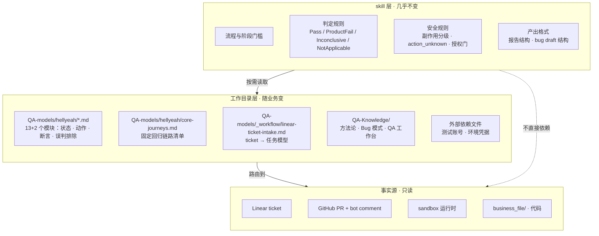
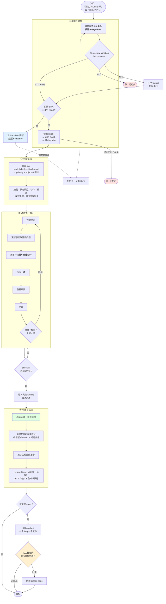
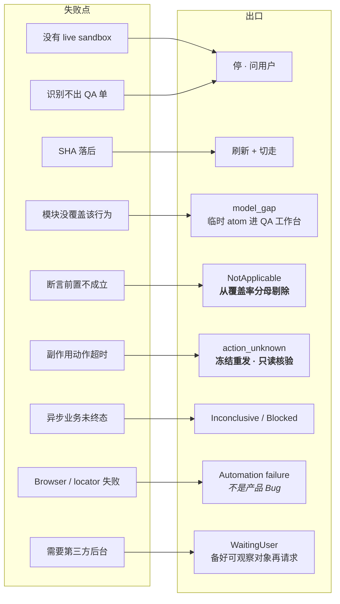
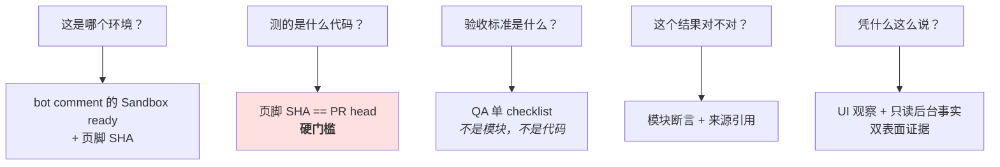
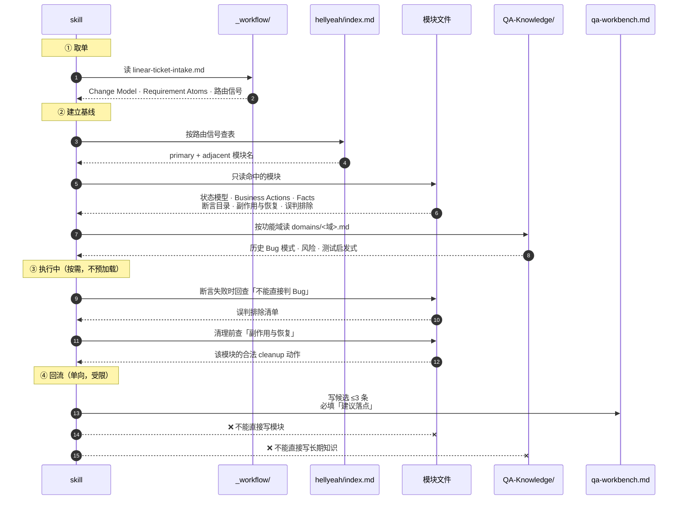
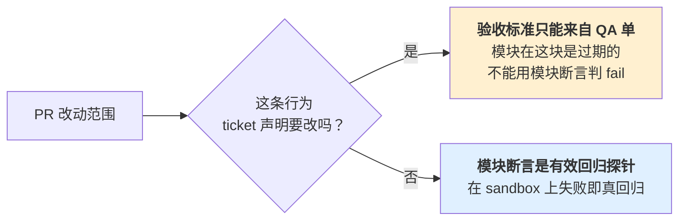
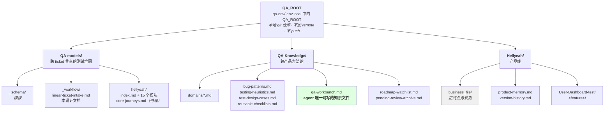

# linear-browser-qa 逻辑图与设计依据

本文是 skill `linear-browser-qa` 的目标设计（2026-09-20 讨论确定），用来回答三个问题：

1. **流程长什么样**
2. **可维护性在哪** —— 改产品时要改哪儿，不该改哪儿
3. **鲁棒性和容错性在哪** —— 哪一步出意外时不会整体失败

> 阅读顺序建议：先看「第 0 节 分层」，它是其余一切的基础。流程图看不懂的地方，回头对照分层就清楚了。
>
> | 节 | 内容 |
> |---|---|
> | 0 | 分层 —— 可维护性从哪来 |
> | 1 | 主流程图 |
> | 2 | 容错性 —— 9 个失败点各自的出口 |
> | 3 | 鲁棒性 —— 结论怎么不被污染 |
> | 4 | **skill ↔ QA-models 调用关系** |
> | 5 | **本地工作目录管理** |
> | 6 | 轻量性 |
> | 7 | 总结 |

---

## 0. 分层：可维护性的全部来源

skill 只有一件事要做——**决定流程怎么走**。它不存任何会变的事实。



**判断一条知识该放哪，只问一个问题：换个产品还成立吗？**

| 内容 | 换个产品还成立？ | 放哪 |
|---|---|---|
| 「副作用动作超时后必须只读核验，不能重发」 | ✅ | skill |
| 「Pass 需要前置成立 + 全部必要断言通过 + 证据完整」 | ✅ | skill |
| 「先测 checklist，再跑最多两条相关风险 smoke」 | ✅ | skill |
| 「Google approve 后自动激活，Meta 要先绑号」 | ❌ | QA-models |
| 「sandbox 地址在 `<!-- preview-sandbox -->` 里」 | ❌ | QA-models / 外部依赖 |
| 「测试账号是 xxx@yyy」 | ❌ | 外部依赖文件 |

**这条分界线就是可维护性本身。**基础设施变了（Railway 换成别的、bot 格式变了）只改工作目录；测试方法论变了才改 skill。两者很少同时变。

---

## 1. 主流程



### 关键顺序（都不可调换）

| 顺序 | 为什么 |
|---|---|
| **先 checklist，后回归** | checklist 已覆盖改动那条链路；回归是看**没改的**链路有没有被搞坏 |
| **先写报告，后清理数据** | 清理会销毁证据。报告落盘后数据没了也不影响复现描述 |
| **先展示 bug 草稿，后建单** | 建 Linear issue 是对外动作，不可撤销 |
| **SHA 校验在测试之前** | 测一个旧构建，所有结论都是废的 |

---

## 2. 容错性：每个失败点都有明确出口

**原则：单点失败只阻塞受影响的目标，不阻塞整轮。**



### 三个最重要的容错设计

**① `action_unknown` —— 防重复副作用**

超时、断开、无响应 **不代表动作没生效**。所有 side-effect 动作（Submit / Approve / Generate / Invite）超时后：

```
记录 action_unknown（动作 · 对象 · 时间 · 页面 · 可关联值）
        ↓
下一动作必须是【只读核验】——查实体、交易、列表、状态
        ↓
禁止盲目重发
```

没有这一条，一次网络抖动就可能变成两次扣款、两个 campaign。

**② `NotApplicable` —— 防覆盖率注水**

断言的 `applies_when` 不成立时（例：环境里已经没有 legacy org），记 `NotApplicable`，**从覆盖率分母剔除并单列**。

它和 `Blocked` 不同：Blocked 有恢复条件，NotApplicable 是这条本来就不适用。

有了它，历史包袱型断言不需要人工逐条清理，agent 自己会绕开。

**③ 状态机而非布尔值**

| 维度 | 取值 |
|---|---|
| 目标状态 | NotRun / Running / WaitingUser / WaitingExternal / Blocked / Pass / ProductFail / Inconclusive |
| 异步状态 | operation_started / business_pending / completed / failed / unknown |
| 复现状态 | observed_once / reproduced / not_reproduced / not_attempted_due_to_risk / blocked / unknown |
| 副作用等级 | read / reversible / side_effect / irreversible |

**没有一处是 true/false。**因为「不确定」是测试中最常见的真实状态，用布尔值表达它必然要撒谎。

---

## 3. 鲁棒性：结论不会被环境噪音污染

### 每个事实锚点都可机器验证



一条也不靠模型记忆或推断。

### 三条硬边界

**① 代码不能定义预期**

```
product_expected  ← 当前有效规则（QA 单 / 模块 / business_file）
code_observed     ← 实现细节，只能解释现象、定位原因
runtime_observed  ← 本轮真实观察
```

三者分开记录。**代码说明「是怎么实现的」，不说明「应该是什么样」。**混用会导致 agent 拿实现当标准，永远测不出 Bug。

**② UI 主权**

用户流程必须走 Browser。只读 API / Admin 只能**交叉核验**，不能代替。

> 不得通过后台接口直接制造一个本应由 UI 完成的「通过」。

**③ 长期知识必须过人工审核**

| 去处 | agent 权限 |
|---|---|
| `version-history.md` | **必须写**（流水账，只记事实） |
| `qa-workbench.md` | **可以写**（≤3 条 / run，`建议落点` 必填，30 天过期） |
| `product-memory.md` | ❌ 只能提候选 |
| `QA-models/*.md` | ❌ 只能提候选 |
| `QA-Knowledge/` | ❌ 只能提候选 |

**agent 只能写流水账和候选。**最坏情况是 QA 工作台积压，但**判断基线永远不会被 agent 自己污染**。

> 这不是假设。本次审计发现：`--pmax` 的正确结论 2026-06-23 就记在 pending-review.md（现 QA 工作台）里，却因无人审核，错误口径在 `domains/campaign.md` 留了近三个月。30 天过期规则就是为此加的。

### 归因边界

sandbox = staging 快照 + PR 改动。只要确认是产品 Bug 就提，**不区分当前 PR 还是 staging 已存在，也不为责任归因做 staging 对照**——反正都要修。环境、部署、账号和 Browser 故障仍单独分类。

QA 的交付物是 **复现条件 + bug 证据**，不是「这是谁的锅」。这条把最容易扯皮、最不可能由 agent 可靠判断的部分移出了范围。

---

## 4. skill ↔ QA-models 调用关系

### 谁在什么时候读什么



**关键：第 ④ 步是单向的。**skill 只能往 `qa-workbench.md` 写候选，永远不能回写模块或长期知识。这保证了下一轮测试的判断基线不会被上一轮的 agent 自己污染。

### 模块提供什么，skill 拿来干什么

| 模块章节 | skill 在哪一步用 | 用途 |
|---|---|---|
| `Ticket 路由信号` | ② 建立基线 | 决定加载哪些模块 |
| `状态模型` | ③ 执行 | 判断当前状态、下一步合法转换 |
| `前置条件` | ③ 执行前 | 前置不成立 → `NotApplicable` 或 `Blocked` |
| `Page Signals` | ③ 每步观察 | 确认 agent 在正确页面 |
| `Business Actions` | ③ 选动作 | 动作意图 + 副作用等级 + recovery |
| `Facts` | ③ 存证 | 只比较已定义 Fact，不让模型猜值 |
| `断言目录` | ④ 判定 | 回归探针的来源（checklist 之外的部分） |
| `副作用与恢复` | ④ 清理 | 该模块的合法 cleanup 动作 |
| `不能直接判 Bug` | ④ 判定 | **误判排除，最高价值的一节** |
| `已知缺口` | ② / ④ | 提示该模块哪里不可信 |

### 模块缺失时的降级链

```
路由不到模块
    ↓
记 model_gap（不阻塞其他目标）
    ↓
本轮允许最小范围探索
    ↓
新理解 → QA 工作台候选（带「建议落点」）
    ↓
❌ 不静默成为永久断言
```

> 现存两个真实 gap：`vendor`（新功能，只有一条孤立断言挂在 settings-members）、`stripe-revenue-connect` / `postback-delivery`（index 里已登记为 `model_gap`）。

### 断言 vs checklist 的分工（最容易搞混的一点）



理由：**模块描述的是 staging 的已验收行为**，而 sandbox = staging + 本 PR 的 delta。ticket 声明要改的部分，模块必然落后于实现。

---

## 5. 本地工作目录管理

### 目录全貌与读写权限



### 权限矩阵

| 路径 | agent 读 | agent 写 | 说明 |
|---|---|---|---|
| `QA-models/_workflow/` | ✅ | ❌ | 流程定义，人工维护 |
| `QA-models/hellyeah/*.md` | ✅ 按路由 | ❌ | 判断基线，只能提候选 |
| `QA-Knowledge/domains/` | ✅ 按功能域 | ❌ | 同上 |
| `QA-Knowledge/qa-workbench.md` | ✅ | ✅ **≤3 条/run** | **唯一可写的知识文件** |
| `Hellyeah/business_file/` | ✅ 仅冲突时 | ❌ | 正式规则，只读 |
| `Hellyeah/product-memory.md` | ✅ | ❌ | 只能提候选 |
| `Hellyeah/version-history.md` | ✅ | ✅ **必写一条** | 流水账，只记事实 |
| `<feature>/` 下全部 | ✅ | ✅ | 本轮产物，自由写 |

### 单次运行的产物落点

```
Hellyeah/User-Dashboard-test/<feature>/        ← feature 主键 = 带 sandbox 的 PR 号
├── tickets/          QA 单快照（取单时落盘，防 Linear 改动）
├── evidence/         截图等证据（报告用相对路径引用）
├── run-state/        agent 运行状态 —— 断了能接上
│   ├── ticket-task-model.md      intake 产出的任务模型
│   └── run-state.md              现场记录：URL · 账号 · 组织 · 最后确认状态
│                                 · action_unknown 清单 · 已创建对象
├── result/           <b>报告，唯一一份 md</b>
│   └── 2026-09-20_14-30_PR-1117.md
│       summary → case 1 → case 2 …
│       成功 case 简略；失败 case 必须有复现条件 + 表现 + trace + 截图引用
└── bug-drafts/       一个 bug 一个文件（英文，待授权）
```

**目录路由优先级**（skill 解析 QA_ROOT 的顺序）：

1. 用户在当前任务明确指定的目录
2. 环境或团队配置提供的 `QA_ROOT`
3. `qa-env/.env.local` 中的 `QA_ROOT`（首次使用由 `pnpm qa:init` 写入）
4. 仍无法确定 → **写操作前询问一次**，绝不把代码仓库或 `/tmp` 当 QA 根目录

### 三条目录纪律

**① 代码仓库和 QA 目录严格分开**

必须从代码仓库运行的命令（`git`、`gh pr view`、代码检索）在代码仓库执行；但**ticket、证据、运行状态、报告、bug 草稿一律写回 QA_ROOT**。

**② 版本目录不覆盖**

报告文件名带时间戳（`YYYY-MM-DD_HH-mm_<topic>.md`），永不覆盖旧报告。版本目录不明确时优先用 ticket ID 或 PR 号单独建目录。

**③ 不写敏感信息**

密码、OTP、token、卡号/CVC、完整 checkout URL、Google 账号、OAuth token、容器/广告账户 ID 全量值——都不落盘。组织和实体 ID 在报告中脱敏。

### 本地 git 的作用

`QA_ROOT` 于 2026-09-20 初始化为**纯本地 git 仓库**（无 remote）。它不是为了协作，是为了：

- 知识库批量修改时能 `git diff` 审阅、能 `git checkout --` 回滚
- 每次审计/沉淀作为独立 commit，判断依据可追溯

⚠️ **不要给它加 remote 也不要 push** —— 目录里有业务文档和内部 QA 资料。

---

## 6. 轻量性

| 机制 | 效果 |
|---|---|
| 执行期不遍历代码/全部业务文档 | 只读 ticket + 命中模块 + 运行证据 |
| 模块按路由信号选，不全加载 | 15 个模块通常只用 1 primary + 1-2 adjacent |
| checklist + 最多两条相关风险 smoke | 控制范围，不跑无关完整主链 |
| 不预先生成完整 test case 矩阵 | 轻量任务包 + 执行中维护事实 |
| 多 feature **严格串行** | 只在等 sandbox 部署时切走，不做复杂调度 |

串行这一条是刻意的：切换 feature 意味着换域名、换登录态、换组织上下文，交错越多，「这个观察是在哪个环境看到的」越容易串。**触发点只有一个（等部署），所以 `run-state/` 按 feature 分片就够了。**

---

## 7. 一句话总结

| 质量 | 实现方式 |
|---|---|
| **可维护性** | skill 存流程，工作目录存事实。基础设施变了不用动 skill |
| **容错性** | 9 个失败点各有明确出口；单点失败只阻塞受影响目标 |
| **鲁棒性** | 每个事实锚点可机器验证；代码不定义预期；长期知识必须人审 |
| **轻量性** | 按需加载，串行推进，不预生成矩阵 |

---

## 附：与现有 skill 的差异

现有 `~/.codex/skills/linear-browser-qa/`（442 行 / 6 文件）尚未包含以下本次设计新增的部分：

- PR / sandbox 解析（含 SHA 硬门槛、`/sandbox` 刷新授权边界）
- feature 概念与多 feature 串行调度
- QA 单识别规则（负责人为决定性信号）
- checklist → 回归的先后顺序
- sandbox 环境限制（不能充值、预置余额、funding gap 即异常）
- 清理判据改为「副作用是否越出 sandbox」
- case 定义（一个功能点 · 业务终点 · 单一角色）
- 报告结构（一个 PR 一份 md）与 bug draft 目录
- `NotApplicable` 状态
- 沉淀配额与过期规则
